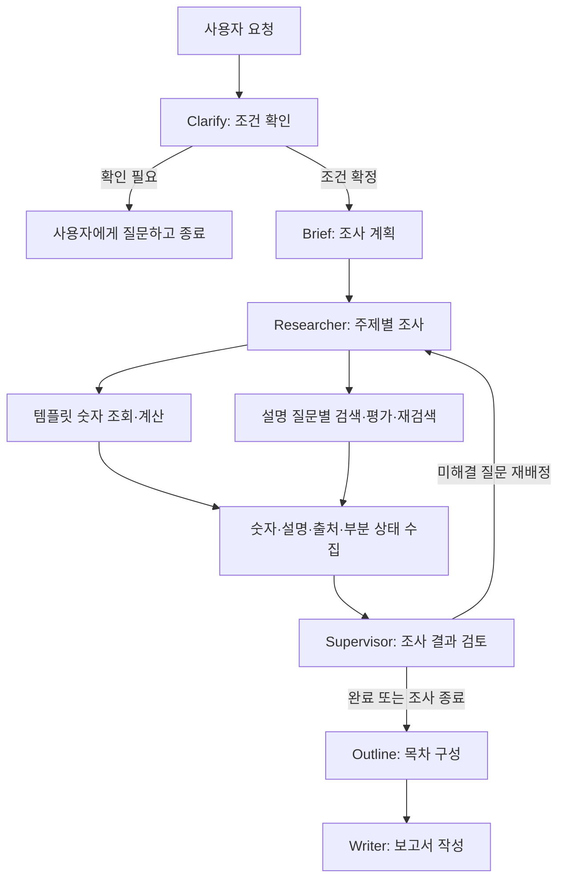

# Research 흐름과 역할 구분: 루프와 오케스트레이션

> 기준: `feat/langchain` 병합 커밋 `edac11d` 이후 코드
>
> 이 문서에서 담당 구분은 개인별 파일 소유권이 아니라 기능의 책임을 의미한다. 팀원 브랜치에서 가져온 코드와 루프 코드는 병합 과정에서 함께 수정되었다.

## 1. 두 역할의 차이

**오케스트레이션은 전체 조사를 계획하고 분배하며 결과를 보고서로 연결한다. 루프는 맡은 질문에 답하기 위해 도구를 실행하고, 근거가 부족하면 다시 검색한다.**

| 구분 | 루프 | 오케스트레이션 |
|---|---|---|
| 핵심 질문 | “이 질문에 답할 근거를 어떻게 확보할까?” | “무엇을 누구에게 조사시키고 결과를 어떻게 정리할까?” |
| 처리 단위 | 질문 또는 숫자 조회 작업 하나 | 사용자 요청과 보고서 전체 |
| 주요 작업 | SQL 조회, 계산, 문서 검색, 근거 평가, 재검색 | 조건 확인, 조사 계획, 주제 분배, 재조사 결정, 보고서 작성 |
| 반복 범위 | 한 질문 안에서 검색어를 바꿔 조사 | 부족한 질문을 Researcher에 다시 배정 |
| 결과 | 숫자·설명·출처·누락 내용·종료 사유 | 주제별 조사 결과와 최종 보고서 |

Researcher는 두 영역의 연결 지점이다. 상위에서는 하위 주제 하나를 맡는 노드이고, 내부에서는 여러 질문을 루프에 전달한다.

## 2. 전체 Research 흐름



예시 요청:

> 서진시스템의 2025년 연결 기준 수익성과 재무 상태를 조사해줘.

```text
[오케스트레이션]
기업·연도·연결/별도 확정
 → 수익성·안정성·현금흐름·리스크로 분배

[루프]
주제별 숫자 조회·계산
 → 설명 질문 검색
 → 근거 충분성 평가
 → 필요하면 재검색

[오케스트레이션]
주제별 완료·부분 성공·실패 확인
 → 부족한 질문만 재조사
 → 목차와 보고서 작성
```

## 3. 루프의 역할

루프는 **고정된 조사 조건에서 맡은 작업의 근거를 확보하는 실행 영역**이다. 보고서 전체의 주제나 목차를 임의로 바꾸지 않는다.

### 3.1 입력 조건 유지

기업·사업연도·연결/별도·접수번호·통화를 고정한다.

```text
기업: 서진시스템 / 00838005
사업연도: 2025
기준: 연결(consolidated)
공시 접수번호: 20260323001543
통화: KRW
```

현재 다중 도구 조사는 단일 기업·단일 사업연도의 원화 연간 실적을 대상으로 한다. 연결 자료가 없다고 별도 자료로 자동 대체하지 않는다.

### 3.2 숫자 조회와 계산

템플릿의 `db_items`와 `db_ratios`를 공통 SQL·계산 도구에 연결한다.

```text
템플릿 지표·비율
 → 코드가 계획 구성
 → PostgreSQL에서 계정 조회
 → 기업·연도·기준·공시 확인
 → 정의된 공식으로 비율 계산
 → 숫자와 출처 보존
```

- 템플릿 숫자 작업은 GPT에게 지표 선택을 다시 요청하지 않는다.
- 설명 조사와 재조사에서 같은 숫자를 반복 조회하지 않는다.
- 숫자 작업은 설명 질문 수 한도에 포함하지 않는다.
- 직접 들어온 비정형 질문은 필요한 경우 Planner가 지원 지표·계산·설명 요구로 분해한다.

현재 별칭 YAML의 조회 지표는 12개다.

| 분류 | 지표 |
|---|---|
| 손익 | 매출액, 영업이익, 당기순이익 |
| 재무상태 | 자산총계, 부채총계, 자본총계, 유동자산, 유동부채 |
| 현금흐름 | 영업활동현금흐름, 투자활동현금흐름, 재무활동현금흐름 |
| 현금 | 현금및현금성자산 |

계산은 부채비율·유동비율·평균 전체자본 기준 ROE·영업이익률을 지원한다. 값이 없거나 계산 조건을 충족하지 못하면 추정하지 않는다.

### 3.3 문서 검색과 재검색

```text
설명 질문
 → 같은 조사 조건의 기존 관련 근거 확인
 → 문서 검색
 → GPT의 근거 충분성 평가
     ├─ 충분: 근거를 인용한 설명 생성
     └─ 부족: 새 검색어로 재검색 또는 보류
```

XML 검색에는 벡터 검색, 제목·핵심어·BM25 검색, 같은 원문 구간의 인접 청크 확장을 적용한다. 인접 확장을 포함한 반환량은 최대 `2 × top_k`다.

기본 XML 경로는 로컬 색인을 사용한다. 로컬 XML이 없으면 공용 Chroma를 확인하며, 공용 XML에도 같은 개선 검색 정책을 적용한다. XML v2는 로컬 해시 색인을 유지하고, PDF 검색은 별도로 선택할 수 있다.

수집 대상은 재무제표·주석과 추가 확보한 감사의견·내부통제 관련 절·경영진 분석이다. 원본에 없는 내용은 생성하지 않는다. 현재 이 경로는 외부 웹 검색을 수행하지 않는다.

### 3.4 상태와 종료 사유 반환

| 상태 | 의미 |
|---|---|
| `draft` | 해당 작업의 필수 요구를 충족했다고 엔진이 판단 |
| `partial` | 숫자나 설명 일부만 확보 |
| `insufficient_evidence` | 답변할 근거가 부족 |

숫자를 확보했더라도 필수 설명이 부족하면 전체 완료로 처리하지 않는다. 지원·미지원 요구가 섞이면 지원 항목을 실행하고 미지원 요구를 별도로 남긴다.

같은 검색어의 반복, 신규 근거 없음, 검색 횟수 한도, 예산 초과 등의 조건에 따라 종료한다. 확인한 숫자·출처·검색 이력은 가능한 범위에서 보존한다.

### 3.5 루프 관련 코드

아래 경로는 저장소 루트 기준이다.

| 파일 | 역할 |
|---|---|
| `src/fin_research/research/loop/planner.py` | 질문을 지원 지표·계산·설명 요구로 분해 |
| `src/fin_research/research/loop/router.py` | 필요한 입력 지표와 도구 순서 결정 |
| `src/fin_research/research/loop/executor.py` | SQL·계산·문서 조사 도구 실행 |
| `src/fin_research/research/loop/tool_graph.py` | 다중 도구 실행과 결과 조립 |
| `src/fin_research/research/loop/graph.py` | 문서 검색·평가·재검색 반복 |
| `src/fin_research/research/loop/evaluator.py` | GPT의 근거 충분성 평가와 출력 정리 |
| `src/fin_research/research/loop/findings.py` | 근거 기반 설명 생성과 인용 형식 확인 |
| `src/fin_research/tools/financial_account_tool.py` | 고정 조건의 계정 조회와 값 선택 |
| `src/fin_research/tools/calc_tool.py`, `ratios.py` | 허용된 재무비율 계산 |
| `src/fin_research/tools/doc_search_tool.py` | 로컬·공용 문서 검색과 인접 청크 확장 |
| `src/fin_research/tools/financial_catalog.py` | YAML 별칭과 조회·계획의 지원 목록 연결 |

## 4. 오케스트레이션의 역할

오케스트레이션은 **사용자 요청을 전체 조사 과정으로 조직하고 최종 보고서로 연결하는 영역**이다. 팀원 브랜치의 상위 그래프·조사 계획·근거 장부·보고서 작성 기능을 활용하고, 병합 과정에서 루프 연결과 상태 정책을 통합했다.

### 4.1 Clarify — 조사 조건 확정

GPT가 요청에서 기업·사업연도·연결/별도·관심 영역을 추출하고 코드가 기업 설정과 대조한다.

- 모호한 조건은 사용자에게 확인한다.
- 연결/별도 미지정 시 연결로 진행한다는 안내를 남긴다.
- 접수번호는 실행 설정·기업 설정·동일 기준의 단일 XML 처리 기록에서 확인한다.
- 하나로 확정할 수 없으면 보류한다.

### 4.2 Brief — 숫자와 설명을 나눈 조사 계획

템플릿이 수익성·재무 안정성·현금흐름·리스크를 정의한다. 숫자는 `db_items`·`db_ratios`에 지정하고 GPT는 기업 특성에 맞는 설명 질문을 작성한다.

| 숫자 작업 | 설명 질문 예시 |
|---|---|
| 매출액·영업이익·당기순이익 조회 | 영업실적 변동의 주요 원인은? |
| 부채비율·유동비율 계산 | 부채 구성과 차입금 만기 구조는? |
| 현금흐름 3종·현금 잔액 조회 | 투자·재무활동의 주요 현금 사용처는? |

지원 범위는 YAML과 계산 목록으로 확인한다. 업계 평균 비교나 임의 비율 계산 등 범위 밖 요구는 제한한다.

리스크 질문은 소송·지급보증·담보제공·감사의견 등 확인 목적을 고정한다. 고정 질문이라도 부족한 근거를 찾기 위한 검색어 구체화는 허용한다.

정형 숫자 조회 미지원과 문서 설명 검색 가능 여부는 다르다. 예를 들어 차입금 구성·만기는 주석에서 확인할 수 있으나, 문서에서 읽은 값을 DB로 검증한 숫자처럼 표시하지 않는다.

### 4.3 Researcher — 상위 계획과 루프의 연결

여러 Researcher가 하위 주제를 나눠 조사한다. 각 Researcher는 템플릿 숫자를 처리한 뒤 설명 질문별로 루프를 실행한다.

`multi_tool_adapter.py`가 다음 연결을 담당한다.

- 상위 조건을 루프의 고정 조사 조건으로 변환
- 템플릿 숫자와 설명 질문을 별도 작업으로 실행
- 루프 결과를 질문별 숫자·설명·출처·상태로 변환
- 공통 근거 장부 등록과 기존 관련 근거 전달
- 상위 재조사에서 이전 숫자·검색 이력 유지
- 중복 숫자 출력 방지

Researcher는 조사 실행을 연결하는 노드이며, 내부 도구와 반복을 수행하는 루프 전체를 뜻하지는 않는다.

### 4.4 EvidenceRegistry — 실행 전체의 근거 공유

팀원의 공통 근거 장부를 사용해 SQL·계산·문서 근거에 전역 `[S1]`, `[S2]` 번호를 부여한다. 같은 파일의 같은 청크는 같은 번호를 사용한다.

다른 Researcher가 찾은 문서도 동일 기업·연도·연결/별도·접수번호 안에서 관련성을 확인해 재사용한다.

> 예: 안정성 조사에서 확보한 매출 감소 원인 문단을 수익성 조사에서도 활용한다.

장부는 근거의 보관·번호·재사용을 담당한다. 등록됐다는 사실만으로 원문 해석이나 답변의 정확성이 검증되는 것은 아니다.

### 4.5 Supervisor — 부족한 질문 재배정

주제별 최신 결과를 모아 완료 여부와 재조사 가능 여부를 판단한다.

1. 완료된 작업은 다시 실행하지 않는다.
2. 부족한 설명만 재조사하고 기존 숫자를 유지한다.
3. 이전 검색어·근거·세션을 다음 라운드에 전달한다.
4. 아직 실행하지 않은 질문을 실패 질문의 재시도보다 먼저 처리한다.
5. 상위 라운드·예산 한도에 도달하면 조사를 종료한다.

기본 구조화 결과는 루프가 남긴 미해결 질문을 재배정한다. 구형 문서 전용 결과에는 기존 질문 재작성 호환 경로가 남아 있다.

### 4.6 Outline → Writer — 보고서 작성

Outline은 코드로 목차와 섹션별 근거를 구성한다.

```text
요약 → 수익성 → 재무 안정성 → 현금흐름 → 리스크 → 결론
```

Writer는 조사 결과·짧은 근거 조각·한계를 입력받아 보고서를 작성한다.

- 부분 성공한 주제의 확인된 숫자·설명도 포함한다.
- 미확인 내용과 부분 확인 상태를 명시한다.
- 입력에 없는 숫자·출처가 추가됐는지 기본 검사한다.
- 검사 실패 시 기존 결과를 이용한 대체 출력을 사용한다.
- 예산이 소진되면 추가 LLM 호출 없이 결과와 한계를 정리한다.

**조사 완료와 보고서 생성 완료는 다르다.** 조사가 일부 미완료여도 그 사실을 표시한 보고서는 생성할 수 있다.

### 4.7 오케스트레이션·팀원 코드의 역할

| 파일 | 맡는 역할 | 병합 후 연결 방식 |
|---|---|---|
| `src/fin_research/research/graph.py` | 상위 LangGraph 구성 | 조사부터 목차·작성까지 연결 |
| `src/fin_research/research/state.py` | 노드 간 공통 자료형 | `partial`, 질문별 결과·출처·검색 이력 포함 |
| `src/fin_research/research/nodes/clarify.py` | 조건 추출·확인 | 연결/별도 조건을 루프까지 전달 |
| `src/fin_research/research/nodes/brief.py` | 조사 계획 구성 | 템플릿 숫자와 설명 질문 분리, 지원 범위 적용 |
| `src/fin_research/research/nodes/researcher.py` | Researcher 진입점·검색 도구 캐시 | 기본은 다중 도구, 문서 전용 호출은 호환용 유지 |
| `src/fin_research/research/multi_tool_adapter.py` | 상위 노드와 루프의 연결 | 우리 실행 경로와 팀원 장부·계획 연결 |
| `src/fin_research/research/nodes/supervisor.py` | 재조사·종료 판단 | 부분 성공 유지, 미해결 질문 재배정 |
| `src/fin_research/research/nodes/common.py` | 공통 실행 설정 접근 | 예산·근거 장부 등을 노드에 전달 |
| `src/fin_research/evidence/models.py`, `registry.py` | 근거 자료형·공통 장부 | 전역 번호와 동일 기준의 근거 재사용 |
| `src/fin_research/retrieval/span_select.py` | 짧은 원문 조각 선택 | 출처 표시와 Writer 입력 보조 |
| `src/fin_research/research/nodes/outline.py` | 목차·섹션별 근거 구성 | 부분 성공 자료도 보고서에 연결 |
| `src/fin_research/research/nodes/writer.py` | 보고서 작성·기본 검사 | 미확인 내용 표시와 예산 소진 시 대체 출력 |
| `configs/report_template.yaml` | 주제·조회 항목·계산·고정 질문 정의 | Brief와 숫자 실행의 공통 기준 |
| `scripts/demo/demo_research.py` | 전체 흐름 실행·결과 저장 | 진행 로그·공통 출처·보고서·JSON 확인 |

팀원 코드인 `research/db_facts.py`는 기존 문서 전용 호출의 호환을 위해 남아 있다. **기본 다중 도구 경로에서는 이 별도 DB 경로를 병렬 실행하지 않고 우리 SQL·계산 도구로 통일한다.**

## 5. 두 반복 구조를 구분하기

| 구분 | 내부 루프의 재검색 | 상위 오케스트레이션의 재조사 |
|---|---|---|
| 판단 대상 | 질문 하나의 근거 충분성 | 주제별 질문의 완료·미완료 상태 |
| 동작 | 검색어를 바꿔 문서를 다시 검색 | 미해결 질문을 Researcher에 다시 배정 |
| 유지 정보 | 누적 근거·검색어·평가 이력 | 기존 숫자·출처·질문별 결과·검색 기억 |
| 한도 | `--loop-rounds` | Supervisor의 상위 `max_rounds` 설정 |

`--questions`는 하위 주제당 한 상위 라운드에서 실행할 **설명 질문 수**다. 템플릿 숫자 작업은 이 한도에 포함하지 않는다.

## 6. GPT와 코드의 분담

| 작업 | 담당 |
|---|---|
| 요청 조건 추출·설명 질문 작성 | GPT, 이후 코드와 템플릿으로 제한 |
| 템플릿 숫자 계획·SQL 조회 | 코드 |
| 허용된 비율 계산 | 코드 |
| 문서 후보 검색 | 검색 도구 |
| 근거 충분성 평가·새 검색어 제안 | GPT |
| 근거 기반 설명·보고서 작성 | GPT |
| 기준 확인·근거 번호·재사용 범위·반복·예산 제어 | 코드 |

현재 Research 판단·작성 역할은 GPT 설정을 사용한다. 주장 추출기의 Qwen 선택과는 별도다.

## 7. 실행 방법

프로젝트 루트의 활성 가상환경에서 실행한다. GPT·PostgreSQL 설정과 해당 공시의 검색 색인이 필요하다.

### 보고서 작성까지 실행

```powershell
python -X utf8 scripts/demo/demo_research.py "서진시스템의 2025년 연결 기준 수익성과 재무 상태를 조사해줘." --rcept-no 20260323001543 --questions 2 --loop-rounds 2 --out data/runs/seojin_merged_research.json
```

### 조사 결과까지만 실행

```powershell
python -X utf8 scripts/demo/demo_research.py "서진시스템의 2025년 연결 기준 수익성과 재무 상태를 조사해줘." --rcept-no 20260323001543 --questions 2 --loop-rounds 2 --research-only --out data/runs/seojin_merged_research_only.json
```

기존 `scripts/demo_research.py` 경로도 호환 진입점으로 유지한다. `--quiet`로 도구 진행 로그를 숨길 수 있다.

## 8. 현재 검증 범위

병합 시 테스트는 **531개 통과·7개 건너뜀**이었다. 모의 모델·DB·검색을 이용한 기능 검증을 포함하며 실제 GPT의 조사 정확도를 의미하지 않는다.

`draft`나 보고서 생성 완료가 원문 해석의 정확성을 보장하지는 않는다. 전기/당기, 연결/별도, 전체/지배주주 금액의 구별, 원인 해석과 설명 모순은 실제 자료로 추가 평가해야 한다.
